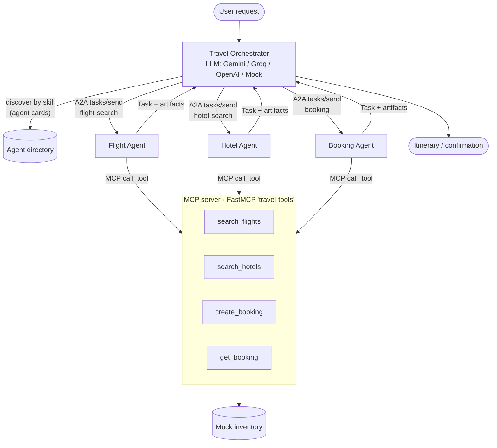
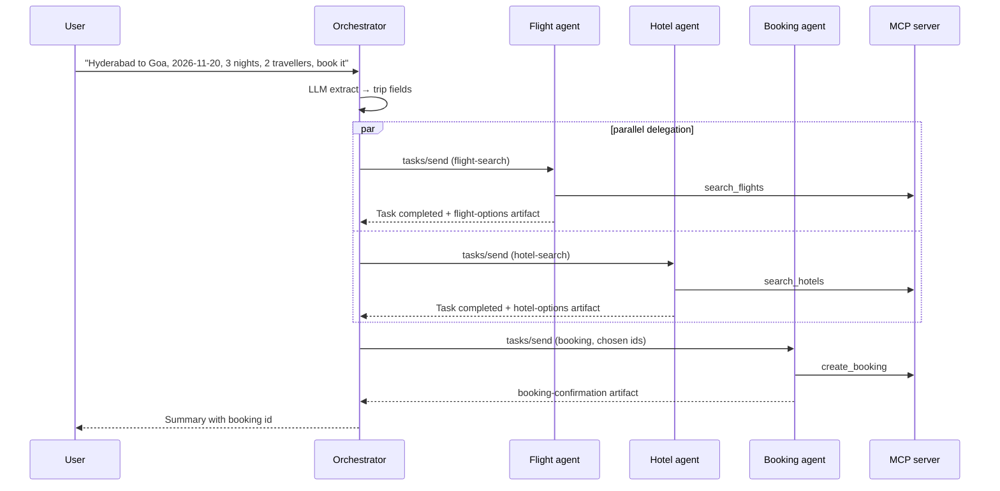

# A2A + MCP Multi-Agent Travel Assistant

A travel assistant built as a small team of agents. An **orchestrator** reads a natural-language request, discovers specialist agents by the skills on their **A2A-style agent cards**, and delegates **tasks** to a **flight agent**, a **hotel agent** and a **booking agent**. The specialists never touch data directly: every search and booking goes through tools exposed by an **MCP server** built with the official `mcp` Python SDK (`FastMCP`).

The LLM is pluggable (**Gemini, Groq or OpenAI**), and a deterministic **mock LLM** plus mock inventory means the full system runs offline with no keys.

## What it demonstrates

- **Agent-to-Agent protocol (A2A-style)**: agent cards with skills, JSON-RPC 2.0 `tasks/send`, a task lifecycle (`submitted → working → completed | failed | input-required`), messages made of text/data parts, and artifacts for results
- **Skill-based discovery and delegation**: the orchestrator finds agents by skill id, not by hard-coded names, and runs flight and hotel searches in parallel
- **MCP tool layer**: `search_flights`, `search_hotels`, `create_booking`, `get_booking` exposed by a `FastMCP` server. Agents call it in-process or over a real **stdio MCP session** (`--stdio`), and the same server plugs into Claude Desktop, Cursor or the MCP Inspector
- **Two transports**: in-process (every task is still serialised to JSON and back, so agents only share the wire format) and HTTP, where each agent is served at its own URL with `/.well-known/agent.json`
- **Pluggable LLM**: used for request understanding (text → structured trip) and the final summary

## Architecture





## Project layout

```
travel_agents/
  protocol.py        AgentCard, AgentSkill, Task, Message, Part, Artifact, JSON-RPC helpers
  transport.py       InProcessTransport, HttpTransport (+ card discovery)
  mcp_server.py      FastMCP server with the travel tools (run it standalone over stdio)
  tools_client.py    InProcessMCPClient, StdioMCPClient (mcp.ClientSession)
  llm.py             Gemini / Groq / OpenAI / Mock providers
  agents/
    base.py          A2A request handling and task lifecycle
    orchestrator.py  Understand → discover → delegate → compose
    flight.py  hotel.py  booking.py
  system.py          Wires agents together in-process
  server.py          Every agent over HTTP as an A2A endpoint
  data.py            Deterministic mock flights, hotels and bookings
tests/test_system.py
```

## Setup

```bash
git clone https://github.com/Manohar8142/a2a-mcp-travel-agents.git
cd a2a-mcp-travel-agents
python -m venv .venv && source .venv/bin/activate   # Windows: .venv\Scripts\activate
pip install -r requirements.txt
cp .env.example .env     # optional: choose an LLM provider and add its key
pytest
```

Requires Python 3.10+. Note `mcp>=1.9,<2` is pinned: the 2.x SDK renamed `FastMCP` to `MCPServer`.

## Environment variables

| Variable | Default | Purpose |
|---|---|---|
| `LLM_PROVIDER` | `mock` | `mock`, `gemini`, `groq` or `openai` |
| `GEMINI_API_KEY` / `GEMINI_MODEL` | — / `gemini-2.5-flash` | Gemini (needs `pip install google-genai`) |
| `GROQ_API_KEY` / `GROQ_MODEL` | — / `llama-3.3-70b-versatile` | Groq |
| `OPENAI_API_KEY` / `OPENAI_MODEL` | — / `gpt-4o-mini` | OpenAI |
| `A2A_BASE_URL` | `http://localhost:8080` | URL written into agent cards in HTTP mode |

## Usage

**CLI (in-process agents, offline):**

```bash
python -m travel_agents "Plan a trip from Hyderabad to Goa on 2026-11-20 for 3 nights, 2 travelers, hotel under 100. My name is Asha Rao. Book it."
python -m travel_agents --stdio "Plan a trip from Bengaluru to Delhi on 2026-12-05 for 2 nights"   # tools over a real MCP stdio session
python -m travel_agents --provider groq "..."                                                      # use a real LLM
```

**HTTP (each agent at its own A2A endpoint):**

```bash
uvicorn travel_agents.server:app --port 8080
curl localhost:8080/agents                                          # directory of agent cards
curl localhost:8080/agents/flight-agent/.well-known/agent.json      # one card
curl -X POST localhost:8080/plan -H 'content-type: application/json' \
     -d '{"text":"from Mumbai to Kochi on 2026-12-10 for 2 nights"}'
```

A raw A2A call to a specialist:

```bash
curl -X POST localhost:8080/agents/hotel-agent -H 'content-type: application/json' -d '{
  "jsonrpc":"2.0","id":"1","method":"tasks/send",
  "params":{"skill":"hotel-search","history":[{"role":"user","parts":[{"type":"data","data":{"destination":"goa","nights":2,"travelers":2}}]}]}}'
```

**Use the MCP server from Claude Desktop / Cursor:**

```json
{ "mcpServers": { "travel-tools": { "command": "python", "args": ["-m", "travel_agents.mcp_server"], "cwd": "/path/to/a2a-mcp-travel-agents" } } }
```

## Example output

`python -m travel_agents` with the mock LLM:

```
A2A TRACE:
  orchestrator -> flight-agent [flight-search]
  flight-agent -> orchestrator [completed] 3 flights found; cheapest Air India at $45.
  orchestrator -> hotel-agent [hotel-search]
  hotel-agent -> orchestrator [completed] 3 hotels found; recommending Sea Breeze Resort (4.5*, $92/night).
  orchestrator -> booking-agent [booking]
  booking-agent -> orchestrator [completed] Booked TRV5001 for $366.

PLAN:
Trip: Hyderabad -> Goa, 2026-11-20, 3 night(s), 2 traveller(s).
Flight: Air India AI379 departs 11:45, 163 min, $45 per person.
Hotel: Sea Breeze Resort (4.5*), $92/night, $276 total.
Booked: TRV5001 for Asha Rao, total $366.
```

All flights, hotels and prices are **mock data** generated deterministically in `data.py`.

## Tests

```bash
pytest -q
```

Covers MCP tool registration, the full plan-and-book flow, the `input-required` path when a traveller name is missing, JSON-RPC success and error responses, HTTP agent cards, and a real stdio MCP session.

## Design notes

- The protocol objects follow the shape of Google's A2A spec (agent cards, tasks, parts, artifacts, `tasks/send`) but are a simplified, dependency-free implementation, not the official A2A SDK.
- Specialists only see protocol messages and MCP tools, so any one of them can move to its own process or service by switching the transport.
- Prices are never produced by the LLM: they come from tools, and the summary prompt tells the model to keep every number exact.

## License

MIT, see [LICENSE](LICENSE).
